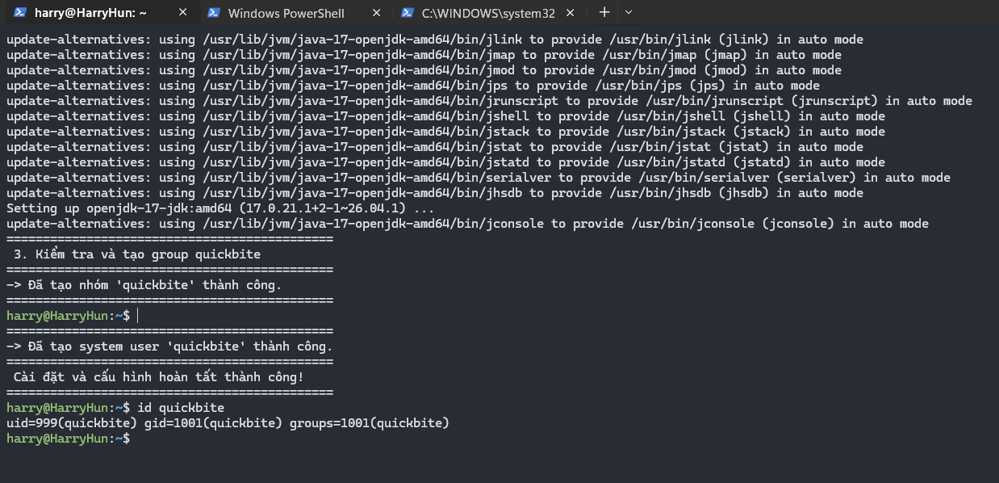

# 🐧 Báo Cáo Thực Hành: Script Cài Đặt Ban Đầu & Tạo User/Group Tự Động

> **Môn học:** Quản trị Hệ thống & Triển khai Linux / DevOps  
> **Bài tập:** Session 01 - Exercise 03: Script cài đặt ban đầu và tạo user/group tự động  
> **Sinh viên thực hiện:** Hà Thúc Quốc Hùng  
> **Môi trường thực nghiệm:** Ubuntu (WSL 2 trên Windows 11)  

---

## 📌 1. Mục Tiêu Bài Tập
- Viết shell script tự động hóa việc cập nhật hệ thống, cài đặt các gói phần mềm bắt buộc (`openjdk-17-jdk`, `git`, `curl`).
- Tự động kiểm tra và cấu hình tạo người dùng hệ thống (`system user`) và nhóm (`group`) bằng dòng lệnh đảm bảo tiêu chuẩn bảo mật khắt khe.

---

## 🛠️ 2. Nội Dung Shell Script (`initial-script.sh`)

Script được thiết kế với các ràng buộc an toàn và tự động hóa:
- `set -e`: Dừng thực thi ngay khi có bất kỳ lệnh nào phát sinh lỗi.
- `apt-get update && apt-get upgrade -y`: Cập nhật kho gói và nâng cấp toàn bộ hệ điều hành.
- `apt-get install -y openjdk-17-jdk git curl`: Cài đặt môi trường runtime Java 17 và các tiện ích.
- **Tạo group:** Kiểm tra bằng `getent group quickbite`, nếu chưa có sẽ tạo qua `groupadd quickbite`.
- **Tạo system user với 2 ràng buộc bảo mật:**
  - Cờ `-r`: Thiết lập tài khoản dịch vụ hệ thống (không tự tạo thư mục home `/home/quickbite`).
  - Cờ `-s /bin/false`: Vô hiệu hóa shell tương tác, ngăn chặn đăng nhập trực tiếp từ bên ngoài.
  - Cờ `-g quickbite`: Gán nhóm chính là `quickbite`.

---

## 🔍 3. Kiểm Thử & Kết Quả Thực Thi

### 3.1. Cấp quyền và chạy script
```bash
chmod +x initial-script.sh
sudo ./initial-script.sh
```

### 3.2. Kiểm tra thông tin User và Group
```bash
id quickbite
```

---

## 📸 4. Kết Quả Kiểm Thử (Hình Ảnh Minh Chứng)

Cửa sổ Terminal chạy lệnh kiểm tra danh tính tài khoản `id quickbite`:



---

## 📂 5. Cấu Trúc Thư Mục Nộp Bài

```text
.
├── README.md
├── initial-script.sh
├── user_verify.png
└── homework/
    └── session_01/
        └── exercise_03/
            ├── initial-script.sh    <-- File script nộp bài
            └── user_verify.png      <-- Ảnh minh chứng nộp bài
```

---

## 🎯 6. Kết Luận
- Đã hoàn thành script tự động hóa cài đặt hệ thống và cấu hình tài khoản dịch vụ an toàn.
- Hệ thống sẵn sàng vận hành các ứng dụng Java/Spring Boot trong các bài thực hành tiếp theo.
